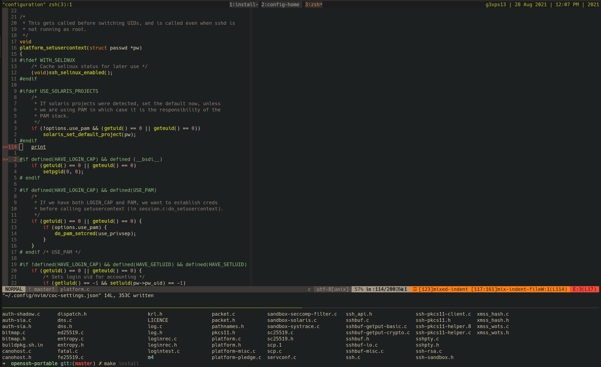

# terminalrc

A collection configurations for an awesome terminal experience.

### Installs and configures:

* bash
* zsh
* From source! (Because why not?)
  * tmux
  * neovim
  * vim
* Nerd fonts
  * SourceCodePro Mono
  * FiraCode Mono
* and gruvbox everywhere _for that sexy look!_

Plus the helpers!

* ripgrep, oh my zsh!, zoxide, fzf

